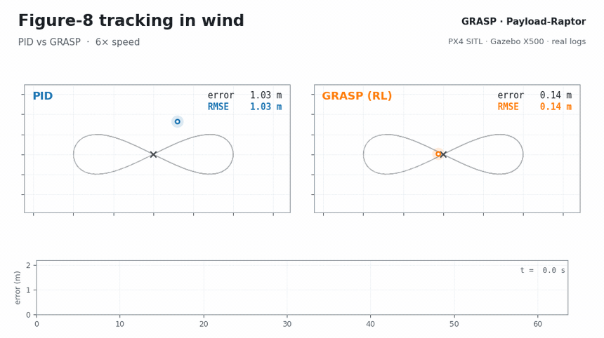
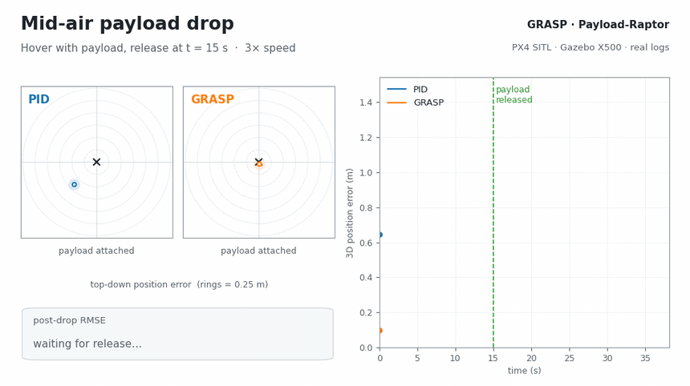
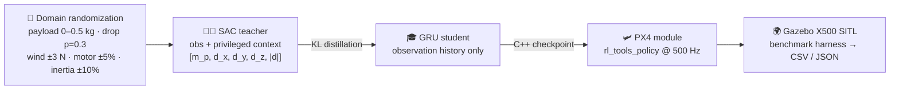

<div align="center">

# 🚁 GRASP · Payload-Raptor

### Quadrotors that *feel* their payload — no payload sensor required.

**G**RU-based **R**obust **A**daptive **S**tudent **P**olicy for quadrotors flying through wind, carrying, swinging and dropping payloads.

[](#-getting-started)
[](embedded_platforms/px4/external_modules/)
[](drone_benchmark/)
[](https://github.com/rl-tools/rl-tools)
[](LICENSE)



<sub>PID (blue) vs GRASP (orange) flying the same figure-8 in wind. Replayed from raw PX4 SITL / Gazebo X500 telemetry.</sub>

</div>

---

## ✨ Why this exists

A drone that picks up a package, gets hit by a gust, or suddenly drops its load sees its dynamics change **mid-flight**. Fixed-gain PID controllers can't re-tune themselves online, so tracking error spikes exactly when it matters.

GRASP learns to **infer the hidden payload mass and wind from motion history alone**, then adapts its control on the fly:

- 🧠 **Teacher → student distillation.** A SAC teacher trains with privileged ground truth (payload mass, wind). A compact **GRU student** learns to match it from observations only.
- ⚡ **Runs inside PX4 at 500 Hz** as an external module, writing straight to `actuator_motors`.
- 🎯 **Measured against PID** on 5 scenario families in PX4 SITL with the Gazebo X500 model. All numbers come from raw CSV telemetry.

## 📊 Results at a glance

<div align="center">

| Scenario | PID RMSE | **GRASP RMSE** | Improvement |
| :--- | ---: | ---: | :---: |
| 🛸 Hover in sustained wind | 0.851 m | **0.190 m** | **4.5×** |
| ∞ Figure-8 (0.6 m/s) | 1.066 m | **0.338 m** | **3.2×** |
| ⭕ Circle (high centripetal accel) | 1.714 m | **0.767 m** | **2.2×** |
| 🌬️ Payload + 4 m/s crosswind | 0.930 m | **0.341 m** | **2.7×** |
| 📦 Payload drop (post-drop recovery) | 0.903 m | **0.138 m** | **6.5×** |

<sub>3D position RMSE, from the GRASP paper benchmark table (manuscript in preparation). PID values for crosswind and payload drop are averages of two runs.</sub>

</div>

<div align="center">

<br/>
<sub><b>Payload released mid-hover at t = 15 s.</b> PID (blue) wanders around the setpoint. GRASP (orange) stays inside the first 0.25 m ring.</sub>
</div>

## 🎬 Watch the head-to-head

Every scenario was flown by both controllers in the same simulated world:

| Scenario | PID | GRASP (RL) |
| :--- | :---: | :---: |
| Hover | [▶ video](drone_benchmark/videos_ok/hover_pid_20260510_015418.mp4) | [▶ video](drone_benchmark/videos_ok/hover_rl_20260511_133441.mp4) |
| Figure-8 | [▶ video](drone_benchmark/videos_ok/figure8_pid_20260510_015844.mp4) | [▶ video](drone_benchmark/videos_ok/figure8_rl_20260511_145657.mp4) |
| Circle | [▶ video](drone_benchmark/videos_ok/circle_pid_20260511_162452.mp4) | [▶ video](drone_benchmark/videos_ok/circle_rl_20260511_164718.mp4) |
| Payload crosswind | [▶ video](drone_benchmark/videos_ok/payload_crosswind_pid_20260511_173504.mp4) | [▶ video](drone_benchmark/videos_ok/payload_crosswind_rl_20260511_155249.mp4) |
| Payload drop | [▶ video](drone_benchmark/videos_ok/payload_drop_pid_20260511_174223.mp4) | [▶ video](drone_benchmark/videos_ok/payload_drop_rl_20260511_170512.mp4) |
| Waypoint drop | [▶ video](drone_benchmark/videos_ok/waypoint_drop_pid_20260510_021230.mp4) | [▶ video](drone_benchmark/videos_ok/waypoint_drop_rl_20260511_165922.mp4) |

## 🧩 How it works



1. **Train the teacher** in the RLtools L2F (Learn-to-Fly) environment with full knowledge of payload mass and wind.
2. **Distill into a GRU student** that sees only a rolling window of standard observations. The recurrent state acts as an implicit payload and disturbance estimator.
3. **Export to C++** and load it as the `rl_tools_policy` PX4 module, toggled through `rl_tools_commander`.
4. **Benchmark**: a Python harness sends OFFBOARD setpoints over MAVLink and logs telemetry for PID and RL alike.

## 🚀 Getting started

```bash
git clone --recurse-submodules https://github.com/khanhngo7879/raptor.git
cd raptor
cmake -S . -B build -DCMAKE_BUILD_TYPE=Release
cmake --build build -j"$(nproc)"
```

Already cloned without submodules? Run `git submodule update --init --recursive`.

**Train → export → fly.** Dynamics parameter generation, teacher pre-training and student post-training live in [`src/payload_policy/`](src/payload_policy/). The PX4 modules that load the exported checkpoint are in [`embedded_platforms/px4/external_modules/`](embedded_platforms/px4/external_modules/).

**Run a benchmark** (with PX4 SITL already running, see [`drone_benchmark/run_rl.sh`](drone_benchmark/run_rl.sh) for the SITL build commands):

```bash
cd drone_benchmark
pip install -r requirements.txt
python main.py --test payload_drop --controller rl     # or pid
python compare.py --logs-dir logs --out-dir plots      # PID vs RL plots
```

Available tests: `hover`, `figure8`, `circle`, `step`, `wind_gust`, `payload_drop`, `payload_crosswind`, `waypoint_drop`.

## 🗺️ Repository map

| Path | What's inside |
| :--- | :--- |
| [`src/payload_policy/`](src/payload_policy/) | Teacher pre-training, student post-training, randomized dynamics parameter sets |
| [`embedded_platforms/px4/external_modules/`](embedded_platforms/px4/external_modules/) | PX4 policy, adapter and commander modules |
| [`drone_benchmark/`](drone_benchmark/) | Scenarios, PID/RL controllers, logs, plots and rendered videos |
| [`include/rl_tools/`](include/rl_tools/) | RLtools library and quadrotor environment foundation |

## ⚠️ Scope

Everything here is **simulation**: PX4 SITL with the Gazebo X500 model. Good simulation results do not mean a policy is ready for real flight. Validate carefully and fly safely if you take it to hardware.

## 🙏 Acknowledgements and license

Payload-Raptor is a research fork of **[RLtools](https://github.com/rl-tools/rl-tools)**, the fast deep-RL library by Jonas Eschmann et al. Its PX4 deployment follows the RAPTOR pattern. Upstream authorship and license notices are kept in the source history and [`LICENSE`](LICENSE).

Released under the **MIT License**, subject to the terms of RLtools and the bundled submodules. When you redistribute, keep the upstream copyright notices.

If this work helps your research, please cite the upstream RLtools paper ([arXiv:2306.03530](https://arxiv.org/abs/2306.03530)) and link this repository for the payload-specific code and experiments.

<div align="center">
<sub>Issues and PRs on payload training, new benchmark scenarios and PX4 integration are welcome ⭐</sub>
</div>
